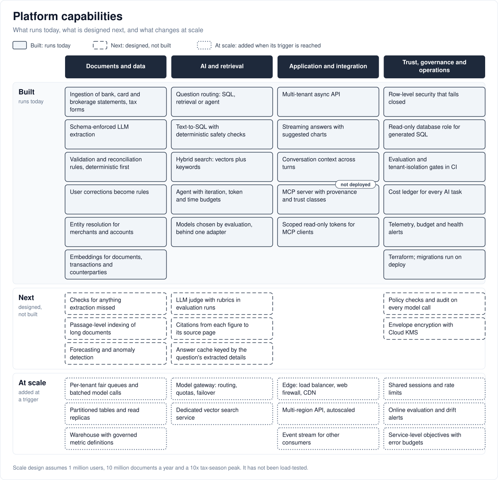
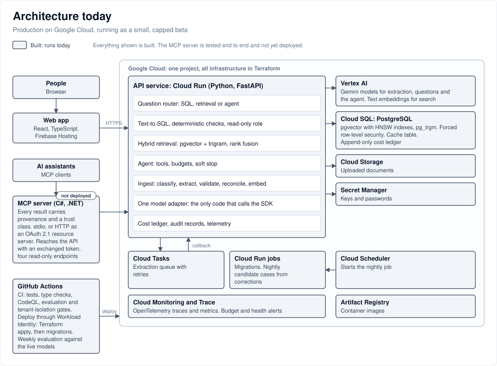
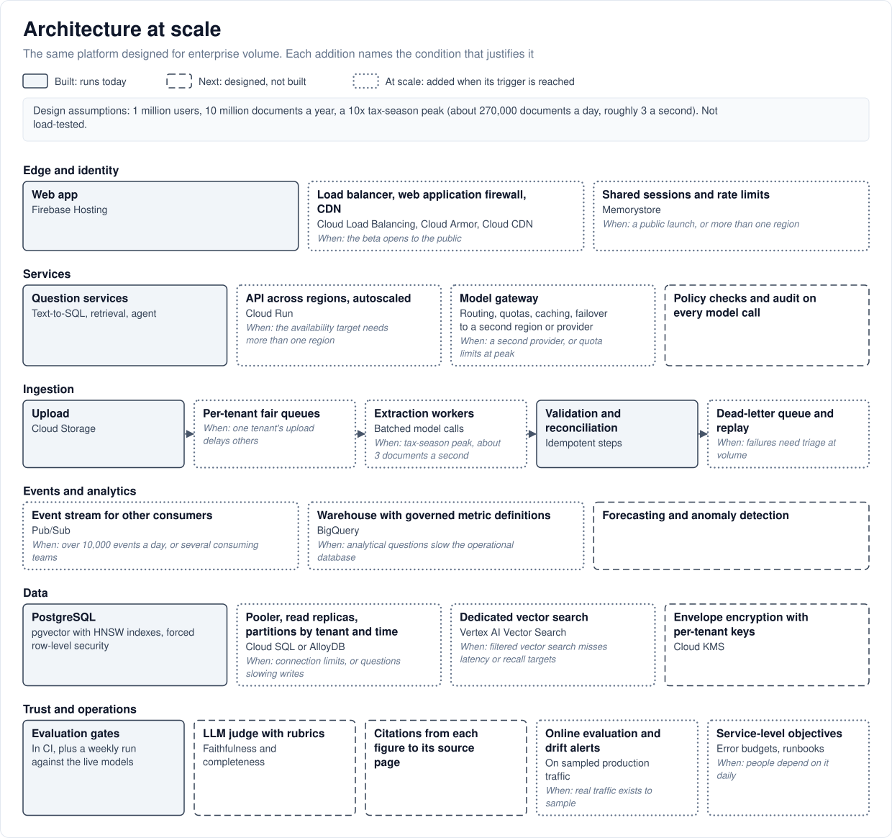

# Finanalytics Hub: architecture, decisions and code

Finanalytics Hub reads financial documents such as bank, credit card and brokerage statements and tax forms, turns them into structured data, reconciles what belongs together across accounts, and answers plain-English questions such as *"What did I spend on consulting last quarter?"* with a suggested chart.

I designed and built it end to end on Google Cloud, starting in February 2026, outside my day job. It is live at [finanalyticshub.com](https://finanalyticshub.com) as a small, capped beta. This repository shares the architecture, the key decisions and [representative code](samples/); the full codebase is private.

Throughout, **Built** means it runs today, **Next** means designed but not yet built, and **At scale** means what I would add for enterprise volume, with the condition that would justify it.

## Design principles

- **Probabilistic where language helps, deterministic where correctness matters.** Models extract, classify and interpret. Validation, schema enforcement, SQL safety and release gates are plain code.
- **Cheap checks before expensive calls.** Deterministic checks run first, so avoidable failures never reach a model.
- **Corrections become rules.** When a user corrects the data, the correction runs before the model next time.
- **Models chosen by evaluation.** A model changes only when the evaluation says so, and only one adapter touches the model SDK.
- **Cost is a design constraint.** Every AI task is recorded with its model, tokens and prompt version.

## Capabilities

## Architecture today

- **Documents.** Each upload is classified, extracted with a schema-enforced model call, validated and reconciled. Reconciliation runs versioned rules, deterministic first. After validation, each document, transaction and counterparty is embedded with a Vertex AI embedding model, and each vector records the model that produced it. Work is queued through Cloud Tasks with retries.
- **Search.** Vectors live in PostgreSQL with pgvector and HNSW indexes, next to trigram indexes for keyword matching. Retrieval runs both and merges the results with reciprocal rank fusion. Text-to-SQL also retrieves similar past questions that produced good SQL and uses them as examples.
- **Questions.** Each question is answered by text-to-SQL, retrieval, or an agent that calls tools, depending on what it asks. Generated SQL passes deterministic safety checks and runs under a read-only database role.
- **Tenancy.** Every tenant table uses forced row-level security in PostgreSQL, so a query without a tenant context matches nothing.
- **Traceability.** Each extracted value traces back to its source document.
- **MCP interface.** A separate server in C# and .NET lets AI assistants read the platform's data through the Model Context Protocol. Every result carries its provenance and a trust class, so text from someone else's document is clearly labelled as untrusted. It is tested end to end and not yet deployed.

## Quality and evaluation

- **Golden datasets for every AI surface:** extraction, classification, questions, retrieval and chat.
- **Deterministic scoring.** Scorers compare structure and values with the expected output. Cases a scorer can't handle yet are skipped and logged, not counted as zero.
- **Gates.** Every change runs the evaluation suite and the tenant-isolation tests in CI, and a deploy proceeds only if both pass. A weekly run against the live models catches drift.
- **A golden set that grows from real use.** New cases are proposed from user corrections, and a person decides what is added.
- **Contract tests from real traffic.** The MCP server's contract tests use payloads captured from the platform's API.

## What's next

- An LLM judge with written rubrics in the evaluation runs, to score what code can't, such as faithfulness and completeness.
- Citations from each figure to the page it came from.
- Passage-level indexing of long documents, so search covers every page and citations can point to it.
- Checks that compare what was extracted against the source document and flag anything missed.
- An answer cache that reuses a stored query only when the question's extracted details match. My [study](https://github.com/rbobba/semantic-cache-inversion) showed why similarity alone isn't enough.
- Policy checks and an audit record on every model call.
- Envelope encryption for stored documents, with keys in Cloud KMS.
- Forecasting and anomaly detection on recurring transactions.

## Designing for scale

The design assumes **1 million users, 10 million documents a year, and a tax-season peak ten times the average.** It has not been load-tested.

- **Documents:** about 27,000 a day on average; about 270,000 a day at peak, roughly 3 a second.
- **Questions:** if a tenth of users ask three questions a day, about 300,000 a day: 3.5 a second on average, 35 at peak.
- **Storage:** at about 1 MB per document, around 10 TB of new documents a year.

| Area | At scale | Worth adding when |
|---|---|---|
| Ingestion | Per-tenant fair queues, batched model calls, a dead-letter queue with replay | One tenant's upload delays others, or tax-season peaks arrive |
| Events | An event stream (Pub/Sub) | Over 10,000 events a day, or several teams consume them |
| API | Autoscaled across regions, behind a load balancer and a web application firewall | The availability target needs more than one region, or a public launch |
| Models | A model gateway for routing, quotas, caching and failover | A second provider is added, or quotas bind at peak |
| Database | Connection pooling, read replicas, partitions by tenant and time | Connection limits, or questions slowing writes |
| Vectors | A dedicated vector search service | Filtered search misses latency or recall targets |
| Analytics | A warehouse (BigQuery) with governed metric definitions | Analytical questions slow the operational database |
| Operations | Online evaluation on sampled traffic; service-level objectives and error budgets | Real traffic arrives and people depend on it |

I designed message brokers, change data capture and event sourcing for this platform and deliberately did not build them: at today's volume, Cloud Tasks does the job at a fraction of the cost. Each addition waits for its condition.

## Key decisions

| Decision | Why | Record |
|---|---|---|
| No LangChain | A direct integration layer is easier to debug, test and control | [Record](docs/decisions/no-langchain.md) |
| Models chosen by evaluation | When candidates tied on extraction, the cheapest tier won, and the tie was treated as a sign the evaluation needed sharper cases | [Record](docs/decisions/model-selection-by-evaluation.md) |
| Cloud Tasks instead of a custom outbox | Durable retries without running a message publisher | |
| No similarity-based answer cache | No similarity threshold avoided wrong reuse in testing, so it was not shipped, and the question became a study | [The study](https://github.com/rbobba/semantic-cache-inversion) |

## Stack

Python, FastAPI, Pydantic and async SQLAlchemy · PostgreSQL with pgvector · Vertex AI (Gemini) · React and TypeScript · Cloud Run, Cloud Tasks, Cloud SQL, Cloud Storage, Secret Manager, Firebase Hosting · Terraform and GitHub Actions · OpenTelemetry · MCP server in C# and .NET

## How this was built

I built this with Claude Code, Anthropic's AI coding assistant. I set the scope and architecture, approved each specification before it was built, made the decisions recorded here (including what not to build), and verified the work through tests, type checks, evaluation gates and by checking claims against the code. Much of the code and documentation was written by the assistant under that direction.

## Limits

- Built and tested mainly on US financial documents.
- A small beta: the scale design has not been load-tested.
- The MCP server is not yet deployed.

## License

[MIT](LICENSE)
